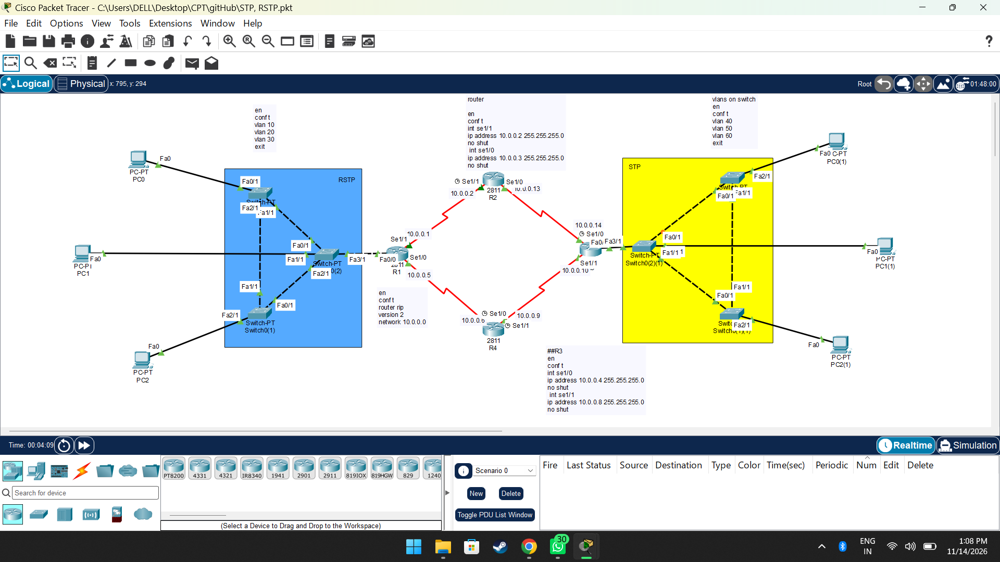

# rstp-stp-vlan-rip-packet-tracer
Cisco Packet Tracer lab: RSTP and STP networks with VLANs, connected through a four-router ring running RIPv2.
# RSTP and STP with VLANs and RIPv2 Routing (Cisco Packet Tracer)

## Overview
This project connects two Layer 2 networks through a ring of four routers. The left network uses **RSTP** (Rapid Spanning Tree) and the right network uses **STP**. Each has three switches wired in a triangle, which creates a loop that spanning tree must handle. The routers run **RIP version 2** so that PCs on both sides can communicate.

## Topology


## Network Design

| Section | Colour | Technology | Details |
|---------|--------|-----------|---------|
| Left LAN | Blue | RSTP (802.1w) | 3 switches in a triangle, VLANs 10, 20 and 30, PC0, PC1 and PC2 |
| Right LAN | Yellow | STP (802.1D) | 3 switches in a triangle, VLANs 40, 50 and 60, PC0(1), PC1(1) and PC2(1) |
| WAN core | - | RIP version 2 | Four routers (R1, R2, R3, R4) connected in a ring with serial links |

- **Redundant links:** The switches in each LAN are connected in a triangle. Spanning tree blocks one path to prevent switching loops, and unblocks it if an active link fails.
- **RSTP vs STP:** The same topology is built on both sides so you can compare how fast each protocol recovers after a link failure. RSTP converges in seconds, while classic STP takes 30 to 50 seconds.
- **Ring of routers:** R1 and R3 connect the two LANs. R2 and R4 provide two alternative paths between them.

## VLANs

| Side | VLAN IDs |
|------|----------|
| RSTP network (blue) | 10, 20, 30 |
| STP network (yellow) | 40, 50, 60 |

## IP Addressing
- **Router-to-router links:** Subnets in the 10.0.0.0 range with /30 masks, for example 10.0.0.0/30 and 10.0.0.4/30 `[list your exact subnets]`
- **User VLAN subnets:** `[add your subnets for VLANs 10 to 60]`

## Technologies Used
- RSTP (Rapid Spanning Tree Protocol)
- STP (Spanning Tree Protocol)
- VLANs
- RIP version 2
- Serial point-to-point links
- Cisco 2811 routers and switches

## Objectives
- Configure RSTP in one LAN and STP in the other
- Create VLANs on each switch
- Identify the root bridge, root ports, designated ports and blocked ports
- Configure RIPv2 across all four routers
- Verify connectivity between PCs on both sides
- Observe the convergence difference between RSTP and STP

## Verification
- `show spanning-tree` to see the root bridge and port roles
- `show vlan brief` to check VLANs
- `show ip route` to check routes learned by RIP
- `show ip protocols` to confirm RIP version 2
- Ping from PC0 (blue side) to PC0(1) (yellow side)
- Disconnect an active switch link and observe how fast the ping recovers on RSTP and on STP

## Sample Configuration
```
router rip
 version 2
 network 10.0.0.0
 no auto-summary
```

## How to Open
Download the `.pkt` file (or the zip) and open it in Cisco Packet Tracer.

## Result
Both LANs run loop-free using spanning tree, the routers learn each other's networks through RIPv2, and PCs on the RSTP side can reach PCs on the STP side.
